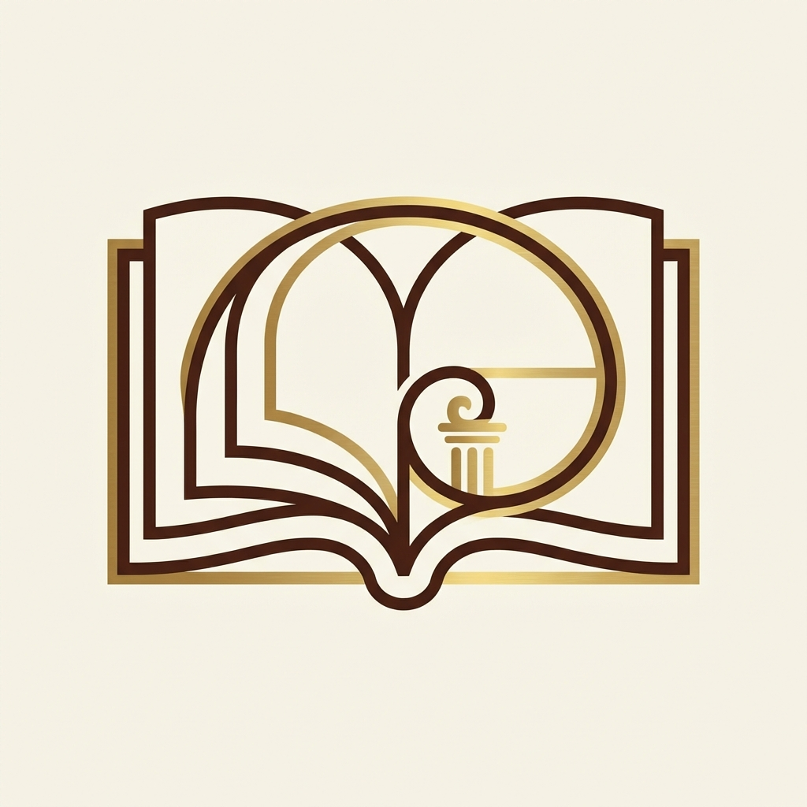

# 📖 Filosofía Cotidiana

**Una bitácora interactiva de sabiduría práctica para el siglo XXI.**

[](https://github.com/damdavidprieto/FilosofiaCotidiana)
[](https://opensource.org/licenses/MIT)
[](https://developer.mozilla.org/en-US/docs/Web/JavaScript)
[](https://damdavidprieto.github.io/FilosofiaCotidiana/)

## 📸 Vista Previa


*(Interfaz Glassmorphism: Reflexiones filosóficas con diseño moderno)*

## 🌟 ¿Qué es Filosofía Cotidiana?

**Filosofía Cotidiana** no es solo una biblioteca; es un compañero diario diseñado para acercar el pensamiento profundo a la vida real. A través de una interfaz elegante y minimalista basada en *Glassmorphism*, transformamos conceptos abstractos de los grandes pensadores en herramientas accionables para tu día a día.

## ✨ Características Principales

### 1. 🧠 Océano de Sabiduría (+60 Conceptos)
Hemos curado una base de datos con **más de 60 conceptos rigurosos** que recorren toda la historia del pensamiento:
- **Clásicos**: Estoicismo (Marco Aurelio, Epicteto), Epicureísmo, Cínicos (Diógenes).
- **Medievales**: Escolástica (Tomás de Aquino, Agustín de Hipona).
- **Modernos**: Racionalismo (Descartes, Leibniz), Empirismo (Hume), Idealismo (Kant).
- **Contemporáneos**: Existencialismo (Sartre, Beauvoir, Camus), Perspectivismo (Ortega y Gasset), Teoría Crítica (Foucault, Arendt).
- **Orientales**: Budismo, Taoísmo (Lao Tsé).

Cada entrada incluye:
- Una **cita verificada** del autor.
- Una **aplicación práctica** real para situaciones modernas.
- Una **pregunta guía** para tu reflexión personal.

### 2. 🧪 Experimentos Mentales & Paradojas
Interactúa con dilemas clásicos como el **Barco de Teseo** o las **Paradojas de Zenón**, diseñados para desafiar tus prejuicios y ampliar tu perspectiva lógica.

### 3. ✍️ Bitácora de Reflexión (Privacidad Total)
Un espacio personal para guardar tus pensamientos. Los datos se almacenan exclusivamente en tu navegador (LocalStorage), garantizando que tus reflexiones más íntimas nunca salgan de tu dispositivo.

## 🚀 Instalación y Uso

Este proyecto es **Pure Vanilla JS**, lo que significa cero dependencias y máxima ligereza.

### Lanzamiento Local
1. Clona el repositorio:
   ```bash
   git clone https://github.com/damdavidprieto/FilosofiaCotidiana.git
   ```
2. Abre `index.html` en tu navegador favorito.
   *(Compatible con el protocolo `file://`, funciona sin necesidad de servidor local).*

## 🎨 Diseño y Aestética

- **Premium UI**: Diseño basado en cristales (Glassmorphism) con animaciones suaves.
- **Tipografía**: Combinación de *Playfair Display* (elegancia académica) e *Inter* (claridad moderna).
- **Mobile First**: Optimizado para que reflexiones desde tu móvil en cualquier parte.

## 🤝 Contribuciones

¿Tienes un concepto filosófico que ha cambiado tu vida? ¡Añádelo!
1. Haz un Fork del proyecto.
2. Crea una rama para tu concepto (`git checkout -b feature/nuevo-concepto`).
3. Realiza un Pull Request.

## 📧 Contacto y Autoría

Proyecto desarrollado con rigor y pasión por **David Prieto**.
- GitHub: [@damdavidprieto](https://github.com/damdavidprieto)

---
*"La filosofía no es solo para académicos. Es para todos los que se hacen preguntas."*

## 📚 Referencias y fuentes

### Conceptos filosóficos

**Estoicismo**
- Marco Aurelio. (c. 170-180 d.C.). *Meditaciones*
- Epicteto. (c. 108 d.C.). *Enquiridión*
- Séneca. (c. 65 d.C.). *Cartas a Lucilio*

**Existencialismo**
- Sartre, J.-P. (1946). *El existencialismo es un humanismo*
- Camus, A. (1942). *El mito de Sísifo*

**Minimalismo filosófico**
- Diógenes Laercio. (c. 300 d.C.). *Vidas de los filósofos más ilustres* (Libro VI: Diógenes de Sinope)

**Memento Mori**
- Tradición estoica romana
- Marco Aurelio. *Meditaciones*, Libro 2

**Navaja de Ockham**
- Guillermo de Ockham. (c. 1320). *Summa Logicae*

### Experimentos mentales

**El Barco de Teseo**
- Plutarco. (c. 75 d.C.). *Vidas paralelas: Teseo*
- Hobbes, T. (1656). *De Corpore*

### Paradojas

**Paradoja del mentiroso**
- Epiménides de Creta (siglo VI a.C.)
- Tarski, A. (1944). "The Semantic Conception of Truth"

**Paradoja de Zenón**
- Zenón de Elea (c. 490-430 a.C.)
- Aristóteles. *Física*, Libro VI

**Si un árbol cae en el bosque**
- Berkeley, G. (1710). *Tratado sobre los principios del conocimiento humano*

### Recursos adicionales consultados

- Stanford Encyclopedia of Philosophy. (2023). https://plato.stanford.edu/
- Internet Encyclopedia of Philosophy. (2023). https://iep.utm.edu/
- Russell, B. (1912). *Los problemas de la filosofía*
- Nagel, T. (1987). *¿Qué significa todo esto? Una brevísima introducción a la filosofía*

## 📄 Licencia

Este proyecto es de código abierto y está disponible para uso educativo.

## 🤝 Contribuciones

Las contribuciones son bienvenidas. Si deseas añadir:
- Nuevos conceptos filosóficos
- Experimentos mentales adicionales
- Paradojas o dilemas éticos
- Mejoras en la accesibilidad

Por favor, asegúrate de incluir referencias bibliográficas apropiadas.

## 📧 Contacto

Proyecto creado por David Prieto
- GitHub: [@damdavidprieto](https://github.com/damdavidprieto)

---

*"La filosofía no es solo para académicos. Es para todos los que se hacen preguntas."*
